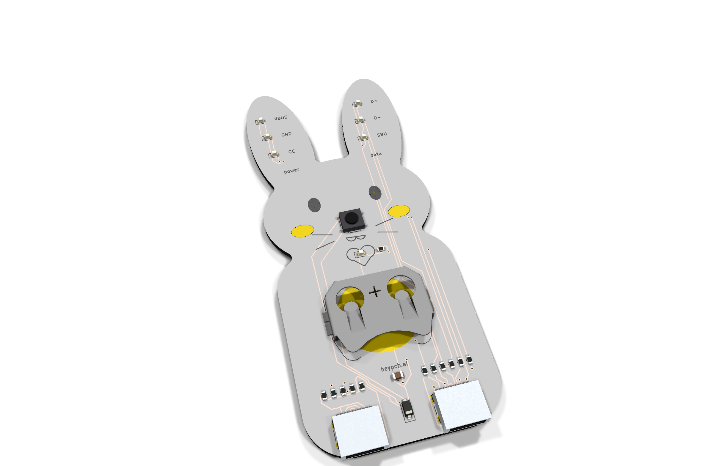
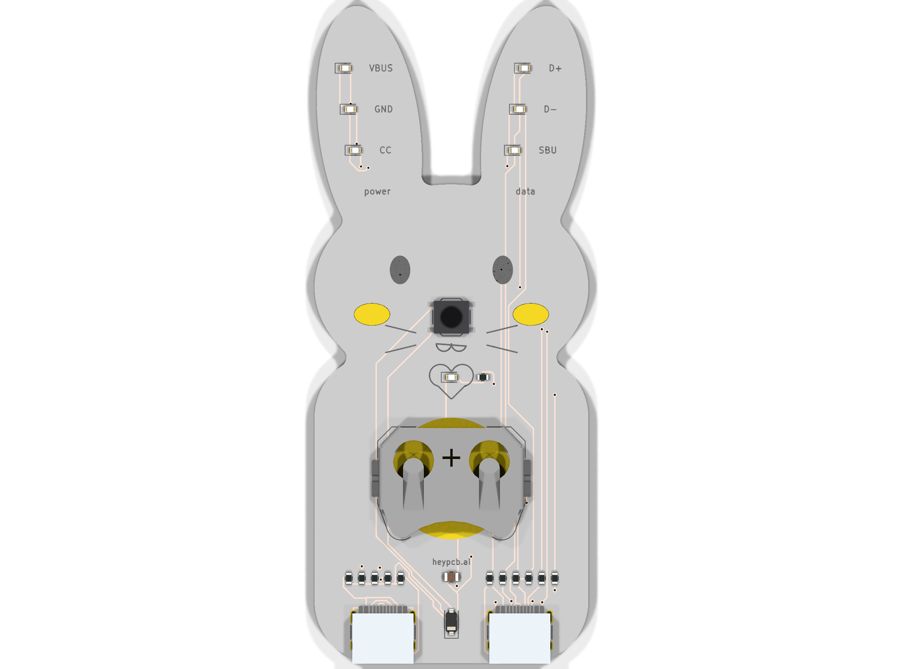
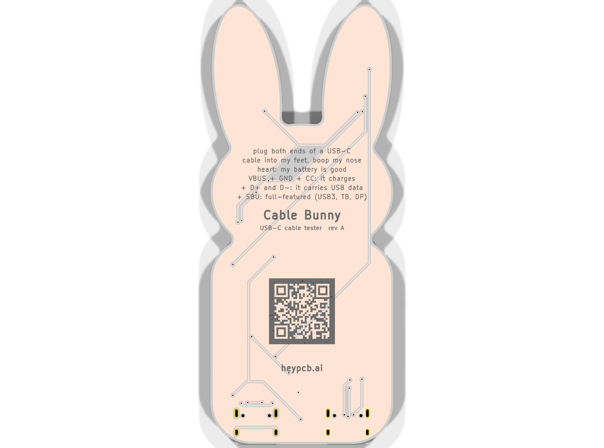

# Cable Bunny

**Is it a charge-only cable? Ask the bunny.**

Cable Bunny is a passive USB-C cable tester shaped like a bunny. Plug both ends of a cable into the two USB-C receptacles that are its feet and press its nose: a CR2032 drives every line of the first receptacle, and every line that reaches the second one lights its own LED in the bunny's ears, VBUS, GND and CC in the left ear and D+, D- and SBU in the right. A heart LED says the cell is good. There is no MCU and no firmware.

| Layers | Size | Parts | Nets | Connections routed | Vias | ERC errors | DRC errors / unconnected / parity | BOM @100 |
|---|---|---|---|---|---|---|---|---|
| 2 | 40.1 x 96.2 mm | 25 | 22 | 58 -> 0 open | 27 | 0 | 0 / 0 / 0 | $0.95 |

**Not fabricated, assembled or powered yet.** Every number on this page is measured by KiCad 10.0.6 on
the files in this repository ([`report.json`](report.json), [`measured.json`](measured.json)) or read
from the live JLC/LCSC catalogue ([`bom_cost.json`](bom_cost.json)).

| | |
|---|---|
| Spec, power budget, BOM | [`SPEC.md`](SPEC.md) |
| Store copy | [`STORE_COPY.md`](STORE_COPY.md) |
| KiCad 10 project | [`kicad/`](kicad/) |
| Gerbers, drill, BOM, CPL, STEP, schematic PDF | [`fab/`](fab/) |
| Firmware | none: no MCU on this board |
| Renders | [front](media/top.png), [back](media/bottom.png), [hero](media/hero.png), [Circuit World thumbnail](media/circuit-world.png) |
| Brief and generator | [`design/`](design/) |

 

## What's on it

- **Source foot (J1):** every line (VBUS, CC, D+, D-, SBU) driven from the test rail through its own 150 Ω, both rows of the receptacle joined so either plug orientation works.
- **Far foot (J2):** each arriving line lights its own 0603 LED through 220 Ω to the far receptacle's ground, which reaches the cell only through the cable's ground wire; the GND LED (330 Ω from the rail) proves that wire. The far shell is not connected.
- **Nose:** a TS-1187A button that connects the cell only while pressed, through a B5819W Schottky that stops a powered cable from back-feeding the lithium cell.
- **Heart:** a red LED on the test rail: if the heart lights and an ear LED doesn't, that wire is broken.
- **Power:** one CR2032 in a Keystone 3034 holder, about 12,000 three-second tests (SPEC.md).

## Finish

White solder mask, Black silkscreen, ENIG copper finish, 1.6 mm FR4, top-side SMT assembly (J1, J2: an SMD part whose shell legs go through plated holes, soldered on the same SMT line).
The gold art is bare copper under a mask opening (ENIG), drawn with its own keep-out so no track runs
under it. The QR code on the back opens [https://heypcb.ai/world/b/e8dc1e4d9cfb](https://heypcb.ai/world/b/e8dc1e4d9cfb).

## How it was made

Designed with the HeyPCB method on KiCad 10.0.6, headless, by the `heypcb-kicad` pipeline: a written
brief composed from reusable circuit blocks, every pin from KiCad's own symbol library, every part bound
to an LCSC number from a dated catalogue read, then ERC, a netlist round trip, locked placement,
Freerouting 2.4.1, pours, silkscreen and board art, DRC with schematic parity, DFM and a fab gate,
each stage gated by a measurement. `design/make_brief.py` regenerates the brief (outline, part
locks and art) from code.

Part of the [heypcb.ai merch collection](https://github.com/HeyPCB/merch).

## License

Hardware: [CERN-OHL-S v2](LICENSE). KiCad's symbol, footprint and 3D
libraries used in the design are CC-BY-SA 4.0 with the KiCad library exception.
